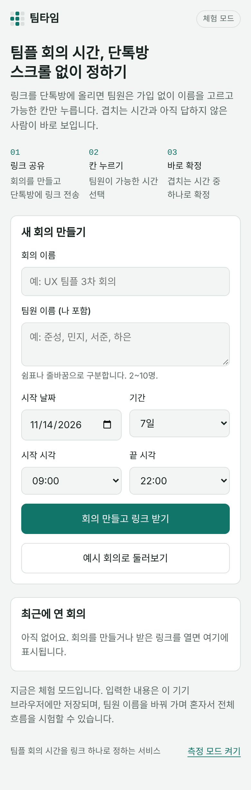
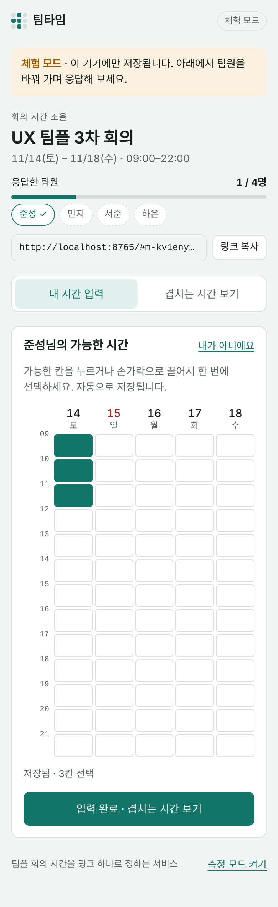
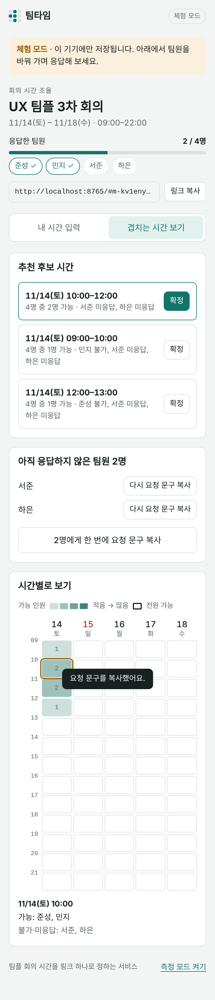

# 팀타임 — 팀 프로젝트 회의 시간 조율 서비스

UX/UI 설계 수업 1인 6주 프로젝트 「대학생 팀 프로젝트 회의 시간 조율 개선」의 기획 내용을 Claude Code로 구현한 웹 서비스입니다.

- 배포 링크(팀원 실시간 공유): https://claude.ai/artifact/DJcZo5pch4bniknPVLeoPo
- 소스 코드: 이 저장소 (`src/teamtime.html` 원본, `index.html` 배포용)
- 개발 프롬프트 기록: [PROMPTS.md](PROMPTS.md)

## 1. 프로젝트 목적

조별 과제에서 회의 시간을 정할 때 팀원들은 단체 채팅방에서 가능한 시간을 묻고, 답을 메모장에 옮겨 적고, 채팅방을 다시 스크롤하며 확인하는 과정을 반복합니다. 답하지 않는 팀원이 한 명만 있어도 확정이 늦어집니다. 팀타임은 링크 하나로 팀원 전원의 가능한 시간을 모아 겹치는 시간을 보여 주고, 아직 답하지 않은 팀원과 확정 결과를 바로 단톡방에 공유할 수 있게 하여 **회의 확정까지의 조작 횟수를 줄이는 것**을 목표로 합니다.

제안서(03장)의 최종 목표: 6주 안에, 같은 가상 팀 일정 시나리오에서 참여자 1인이 회의 확정 결과를 확인하기까지의 조작 횟수를 평균 15회(가상값)에서 5회 이하로 줄인다.

## 2. 기획 요구사항과 구현 기능

| 기획 근거 | 사용자 요구사항 (06장) | 구현한 기능 |
|---|---|---|
| 응답을 메모장에 옮기고 채팅방을 다시 스크롤함(C01, I01) | R1. 조장은 모든 팀원의 가능한 시간을 한 화면에서 겹쳐 보고 후보를 고를 수 있어야 한다 | 가능 인원 수에 따라 진해지는 시간표 히트맵, 전원 가능 칸 표시, 칸을 누르면 가능한 사람·불가한 사람 표시, 추천 후보 시간 3개 자동 정리 후 한 번에 확정 |
| 시간표 확인 부담으로 답을 미루고, 외부 서비스 가입 화면에서 이탈함(I02, I03) | R2. 팀원은 가입 없이 링크에서 가능한 시간을 입력할 수 있어야 한다 | 가입·로그인 없이 이름만 고르고 시간표 칸을 누르거나 끌어서 선택, 자동 저장 |
| 미응답 팀원에게 개인 메시지를 따로 보내고 확정이 지연됨(C03, I03) | R3. 조장은 미응답 팀원을 확인하고 개인 연락 없이 다시 요청할 수 있어야 한다 | 응답 현황 막대와 이름 칩, 미응답 팀원 목록, 개인별·전체 다시 요청 문구 복사 |
| 결과를 캡처해 단톡방에 다시 올림(M21) | To-be 5단계: 확정 결과를 단톡방에 공유 | 확정 시 단톡방 공지 문구 자동 생성·복사 |
| 성공 지표: 확정까지 조작 횟수 | 사용성 테스트(5주차) 측정 | 화면 아래 '측정 모드'를 켜면 누른 횟수를 세어 표시 |

## 3. 사용 방법

1. 처음 화면에서 회의 이름, 팀원 이름(나 포함), 날짜 범위, 시간 범위를 입력하고 **회의 만들고 링크 받기**를 누릅니다.
2. **링크 복사**로 안내 문구와 링크를 복사해 팀 단톡방에 붙여 넣습니다.
3. 팀원은 링크를 열고 자기 이름을 고른 뒤 가능한 칸을 누르거나 끌어서 선택합니다(자동 저장).
4. **겹치는 시간 보기**에서 추천 후보를 확인하고 **확정**을 누릅니다. 미응답 팀원이 있으면 다시 요청 문구를 복사해 보냅니다.
5. 확정 후 **단톡방 공지 문구 복사**로 결과를 공유합니다.

처음 둘러볼 때는 **예시 회의로 둘러보기**를 누르면 가상 팀원 응답이 들어 있는 예시 회의가 열립니다(제목에 [예시] 표시).

## 4. 실행·배포 방식

| 방식 | 데이터 저장 | 용도 |
|---|---|---|
| 배포 링크 (claude.ai) | 서버의 공유 저장소. 여러 사람의 응답이 실시간으로 합쳐짐 | 실제 팀 사용. 응답을 저장하려면 링크 소유자가 공유 메뉴에서 해당 팀원에게 편집(참여) 권한을 주어야 함 |
| GitHub Pages 또는 `index.html` 직접 열기 | 체험 모드: 이 기기 브라우저에만 저장 | 시연·평가용. 한 기기에서 팀원 이름을 바꿔 가며 전체 흐름을 시험 |

공유 링크를 보기 권한으로만 연 사람은 '보기 전용' 안내와 함께 **체험 모드로 열기** 버튼이 나타나 같은 기능을 직접 시험할 수 있습니다.

### GitHub Pages로 배포하기
1. GitHub에서 새 저장소를 만들고 이 폴더의 파일을 모두 올립니다.
2. 저장소 **Settings → Pages**에서 Branch를 `main`, 폴더를 `/ (root)`로 선택하고 저장합니다.
3. 1~2분 뒤 표시되는 `https://<아이디>.github.io/<저장소>/` 주소가 실행 링크입니다.

### 로컬에서 실행하기
`index.html`을 브라우저로 열면 됩니다. 원본(`src/teamtime.html`)을 고친 뒤에는 `python3 tools/build.py`로 `index.html`을 다시 만듭니다.

## 5. 기술 구성

- HTML·CSS·JavaScript 단일 파일, 외부 라이브러리 없음 (글꼴만 Google Fonts 사용)
- 모바일 우선 레이아웃(최대 폭 560px), 라이트·다크 모드 지원, 가로 스크롤 없음
- 저장소 어댑터 구조: 배포 환경에서 공유 저장소(`db`)를 쓸 수 있으면 실시간 공유, 아니면 `localStorage` 체험 모드로 자동 전환
- 데이터 구조: `meetings/{회의ID}`(제목, 팀원, 날짜, 시간 범위, 확정 시간), `meetings/{회의ID}/responses/{팀원키}`(이름, 선택한 칸 목록)
- 시간표 입력은 Pointer Events로 클릭·터치 드래그를 모두 지원하고, 키보드(Enter/Space)로도 선택 가능
- 후보 시간 계산: 같은 날 연속된 시간 중 가능한 사람 구성이 같은 구간을 묶고, 가능 인원 → 구간 길이 → 날짜 순으로 정렬

## 6. 화면

| 처음 화면 | 시간 입력 | 겹치는 시간 |
|---|---|---|
|  |  |  |

## 7. 한계와 다음 단계

- 개인 캘린더 연동, 푸시 알림, 과제 관리 기능은 제안서의 제외 범위에 따라 구현하지 않았습니다.
- 팀원 본인 확인 없이 이름만 고르는 방식이라, 다른 사람 이름으로 입력하는 것을 막지 않습니다(가입 없는 응답을 우선한 설계 선택).
- 목표 지표(조작 5회 이하)는 아직 실제 참여자로 측정하지 않았습니다. 측정 모드로 사용성 테스트를 진행해 실측값으로 확인할 예정입니다.
